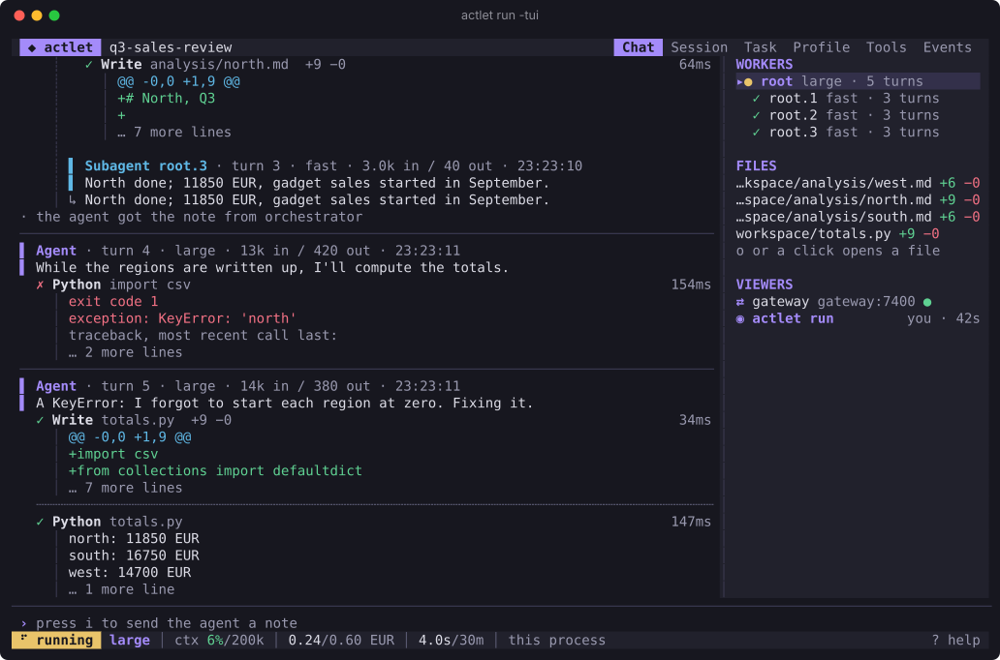
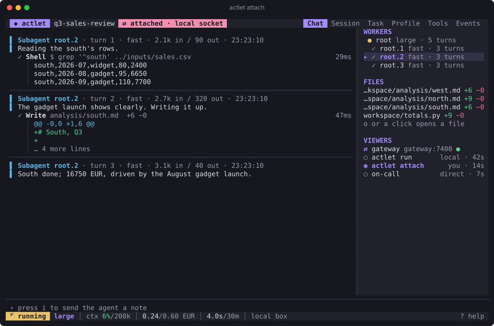
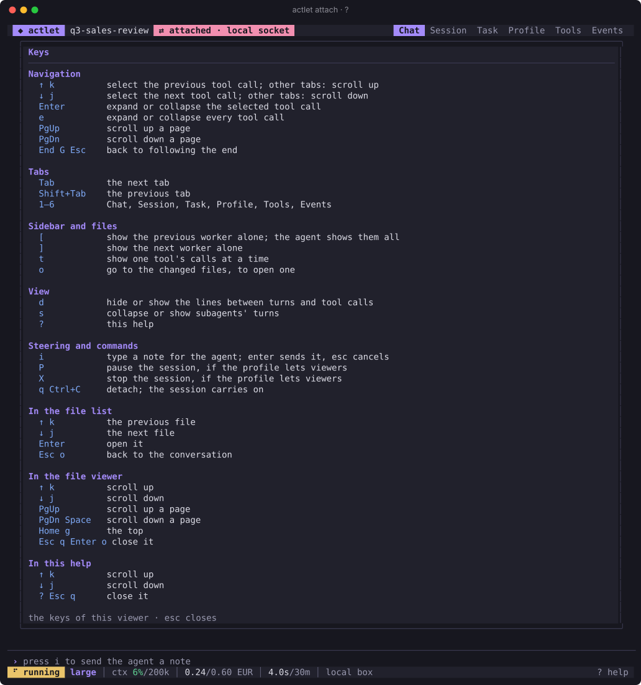
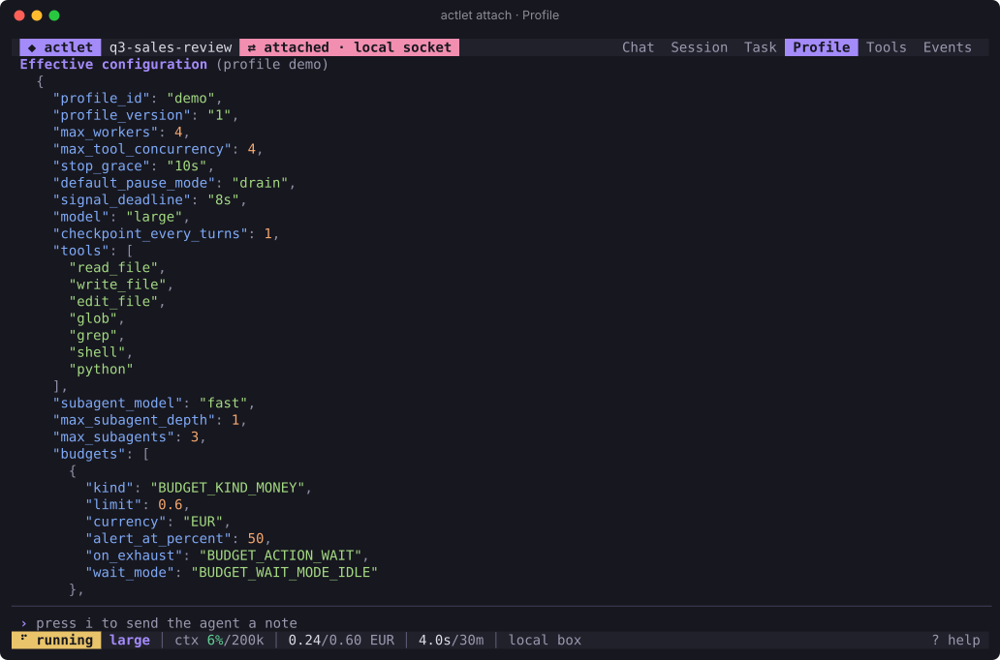
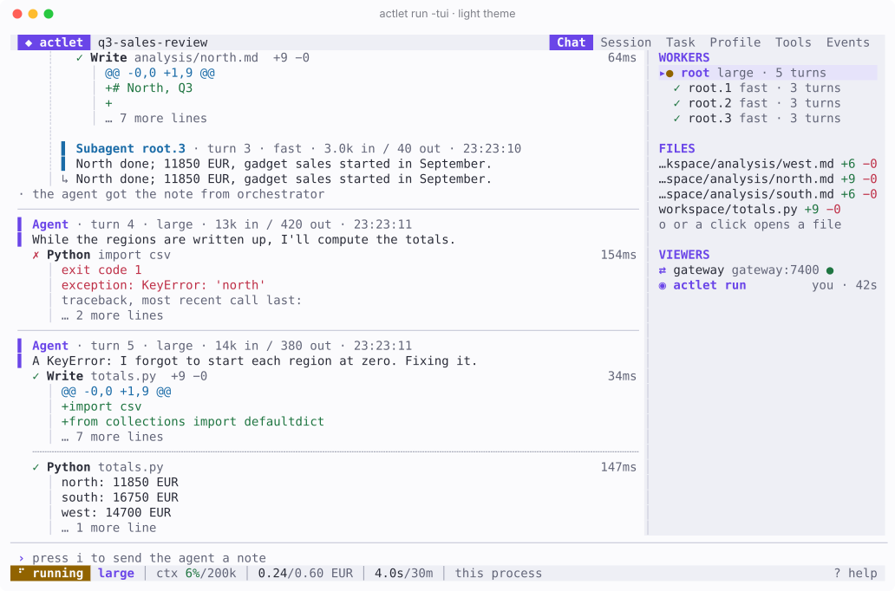

# Actlet

**Drop in a task. Pick up deliverables.**

Actlet is a small agent runtime, written in Go, that runs inside an isolated container or sandbox. Give it a task and a folder of inputs; it works the task with a model and local tools, and leaves its deliverables in `output/`. An orchestrator you run controls it: Actlet connects out for its profile, models and remote tools, and does the work locally. It journals everything, so a paused, stopped or crashed session picks up where it left off, and it streams what it does, so you can watch a session live or replay it later. Normal runs are headless; a terminal viewer attaches when you want to look.



Actlet is deliberately not a web app, a model-provider gateway, a sandbox manager or an orchestration platform. Those concerns live outside it.

## Quick start

```sh
make demo-tui
```

This builds Actlet and runs a scripted demo of about two minutes, with no real model, in the terminal viewer: an agent hands three regions of a sales review to subagents, runs shell commands and Python (one script fails and is fixed), edits a report, and gets an operator's note and a budget alert half-way. In a second terminal, `make demo-attach` attaches another viewer to the same box. Press `?` for the keys and `q` to quit; quitting detaches, and the session carries on. Requirements: Go 1.27.3 or newer and GNU Make.

## Features

- **One session per container.** `actlet run` connects to the orchestrator's gateway, registers its session and runs its task. The orchestrator pauses, stops and steers it ([gateway protocol](docs/gateway-protocol.md)).
- **An agent with tools.** [The agent](docs/agent.md) calls models through the gateway and works with local tools (files, search, shell, Python) and standard ones (progress reports, feedback, decisions, side calls to other models). Tool calls and subagents run in parallel, and operators can steer it with notes. [Skills](docs/agent.md#skills) and [context compaction](docs/agent.md#context-compaction) come built in.
- **Budgets.** [Budgets](docs/profiles.md#budgets) limit a session's time, cost, tokens and disk space, and the orchestrator can change limits and budgets while it runs.
- **Crash-safe.** A local [journal](docs/journal-format.md) records every call, so recovery never repeats a side effect. Nothing a tool starts outlives the run. A session can be [forked](docs/fork.md) from any of its checkpoints.
- **Watch it, live or later.** A [terminal viewer](docs/tui.md) shows a session as it runs: in its own terminal, attached on the same machine, or from anywhere through the orchestrator. It replays recordings too, and searches them. Themes, syntax highlighting, and a list of who else is watching.
- **An orchestrator SDK.** [`sdk/`](sdk) is a Go library for writing the orchestrator's side, with [adapters](docs/providers.md) for Anthropic, OpenAI and compatible endpoints, nexos.ai, and typesafe.ai. `actlet-devgw` is a development gateway built on it.
- **Small and static.** CGO-free binaries for Linux, macOS and Windows, on amd64 and arm64, and a distroless container image. See what it [costs](docs/performance.md).

| | |
|---|---|
|  |  |
|  |  |

The screenshots are drawn from the demo's recording by `make screenshots`.

## Documentation

| Read | For |
|---|---|
| [Watching a session](docs/tui.md) | the terminal viewer: attaching, replays, search, themes |
| [The agent](docs/agent.md) | how the agent works, its tools, skills, compaction and recovery |
| [Profiles](docs/profiles.md) | configuring a session: models, tools, budgets, limits |
| [Gateway protocol](docs/gateway-protocol.md) | what an orchestrator implements, and the SDK that does it |
| [Model providers](docs/providers.md) | routing model calls to Anthropic, OpenAI and others |
| [Forking](docs/fork.md) | starting a new session from another's checkpoint |
| [Journal format](docs/journal-format.md) | the crash-recoverable record each session keeps |
| [Kubernetes](docs/kubernetes.md) | running sessions as pods |
| [Security](docs/security.md) | the threat model: what Actlet trusts and how each surface is defended |
| [Performance](docs/performance.md) | what Actlet costs, measured |

## Status

Version 0, in early development. Every protocol and format is experimental and may change incompatibly before 1.0; [compatibility fixtures](test/compat) capture each version, so that a change is visible. `actlet-cli` holds the tools for journals and recordings (`journal inspect|export`, `replay inspect|export|view|search|play`), attaches to sessions and forks them; it never runs a session.

## Running a session

```sh
make build
bin/actlet-devgw -token dev &
ACTLET_GATEWAY=127.0.0.1:7400 ACTLET_TOKEN=dev bin/actlet run -session ./demo-session
```

This runs the demo task; to run the agent with a scripted model, see [trying the agent](docs/agent.md#trying-it). Type `pause drain`, `stop kill` or `steer <note>` into `actlet-devgw` to control the session. Give it a [profile](docs/profiles.md) with `-profile <file>`. `actlet run` exits with 0 when the task completes, 3 when it pauses and 4 when it is stopped. Run it again on the same folder to resume a paused session. `actlet run -h` lists every flag and its environment variable.

A session lives in one folder:

```
task.json     the task definition and input (written from the gateway's task if missing)
inputs/       input files
workspace/    the working directory
output/       deliverables
.actlet/      the journal, a status marker and the activity spill
```

## Building and testing

Requirements: Go 1.27.3 or newer and GNU Make. `make setup` installs the pinned versions of `golangci-lint`, used by `make check`, and of `protoc-gen-go` and `protoc-gen-go-grpc`, used by `make generate` (which also needs `protoc`).

```sh
make setup   # download modules, install development tools
make build   # build bin/actlet, bin/actlet-cli and bin/actlet-devgw
make test    # run the tests with the race detector, and a short fuzz run
make test-docker  # recovery across container replacement (needs Docker)
make test-k8s     # the gateway path through Kubernetes, in a throwaway kind cluster
make check   # gofmt, go vet, golangci-lint, go.mod tidiness
make bench   # run the benchmarks
make help    # list every target
```

Binaries are static and CGO-free and run natively on Linux, macOS and Windows, on amd64 and arm64.

```sh
make dist         # cross-build actlet, actlet-cli and actlet-devgw for all six platforms into dist/
make image        # build the actlet:dev container image (distroless, non-root)
make image-devgw  # build the actlet-devgw:dev development gateway image
```

For Kubernetes, see [running on Kubernetes](docs/kubernetes.md): what was tested and the recommended settings.

The image runs as an unprivileged user with its working directory at `/var/lib/actlet`. To keep sessions across container replacement, mount a volume there. The container's own filesystem only survives a restart of the same container.

```sh
$ bin/actlet version
$ bin/actlet help
```
